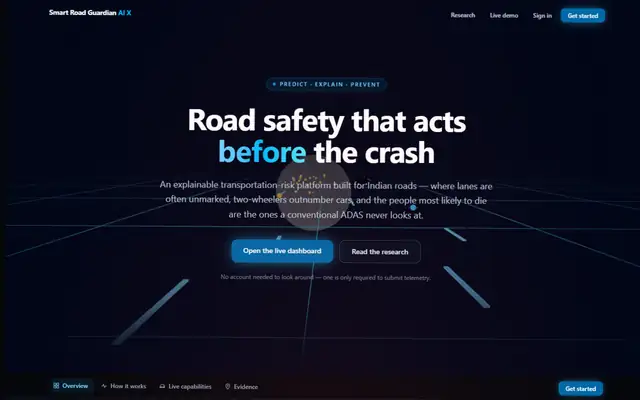
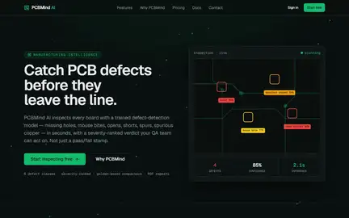
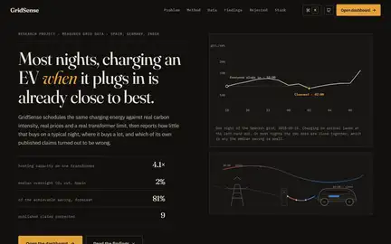

# Aditya Ayushman Sahoo

### AI/ML Engineer · Computer Vision · Explainable AI

**I build end-to-end, explainable machine learning systems: model, API and deployed dashboard.**

  
  
  
  

Open to 2027 ML and software engineering roles and internships.

---

### At a glance

**6 live ML products** · **1 published research preprint** · **5 internships** · **300+ LeetCode problems** · Final-year B.Tech CSE (AI & ML), SRM IST, graduating 2027

---

### Demos

<table>
  <tr>
    <td align="center" width="33%">
       
      <b>Smart Road Guardian AI X</b> Road-accident risk, explained
    </td>
    <td align="center" width="33%">
       
      <b>PCBMind AI</b> PCB defect inspection from a photo
    </td>
    <td align="center" width="33%">
       
      <b>GridSense</b> Carbon-aware EV charging
    </td>
  </tr>
</table>

---

### Featured projects

Each one runs live, with source and documentation on GitHub.

| Project | Result | Live |
|---|---|---|
| **[Smart Road Guardian AI X](https://github.com/adityaayushman/TRIE)** | Explainable edge-AI that scores road-accident risk in real time. Road-damage detection reaches 33% mAP50 on held-out Indian images, and a learned risk model beats the hand-set rule (AUC 0.78 → 0.82) | [Live](https://trie-dashboard.vercel.app) |
| **[PCBMind AI](https://github.com/adityaayushman/pcb-mind)** | Upload a board photo and get annotated defects, severity and a QA report in seconds, with golden-board comparison and an LLM copilot | [Live](https://pcbmind-ai.vercel.app) |
| **[GridSense](https://github.com/adityaayushman/GRIDSENSE)** | Schedules home EV charging against real grid carbon and price data. One street transformer hosts about **4× more EVs** (median 4.1× over 20 fleet draws, range 3.3–5.3×) | [Live](https://gridsense-app-drab.vercel.app) |
| **[MedChron AI](https://github.com/adityaayushman/medvision)** | Brain-MRI tumor classification at 85.7% accuracy and ROC-AUC 0.969, with Grad-CAM explanations and a patient Digital Twin | [Live](https://medchron-ai.vercel.app) |
| **[CloudOptima](https://github.com/adityaayushman/Cloud-Resource-Optimizer)** | In closed-loop simulation on real cloud traces, cuts cost 19–40% against an ML-only baseline, with task failures under 1% | [Live](https://cloud-resource-optimizer.vercel.app) · [API](https://cloud-resource-optimizer-api.onrender.com/docs) |
| **[Pre-Impact Fall Anticipation](https://github.com/adityaayushman/FBimpact)** | Predicts a fall before impact and names the joints that signalled it. Runs at 61 fps on GPU and 28.6 fps on CPU, and only skeletons are sent to the server | [Live](https://fbimpact.vercel.app) · [API](https://fbimpact-api.onrender.com/docs) |

---

### Achievements

| | |
|---|---|
| **Published research** | *Cloud Computing Resource Optimizer*, SSRN preprint (2026). XGBoost forecasting + Deep Q-Network autoscaling with explainable AI. [Read the paper](https://papers.ssrn.com/sol3/papers.cfm?abstract_id=6957438) |
| **5 industry and research internships** | Research Intern at **KIIT** (AI medical imaging) · Flutter Developer at **Osswal Infosystem** (SAP partner) · AI/ML at **Kukreja's Wastec** (PCB defect inspection) · **Syllogistek Systems** · **Silicon Institute of Technology** |
| **Leadership** | Committee Head at **Aaruush**, SRM's national techno-management fest · Committee Member, **SRM MUN Society** |
| **Problem solving** | 300+ problems solved on [LeetCode](https://leetcode.com/u/AdityaAyushmanSahoo/), including about 65 Hard |
| **Certifications** | NPTEL Java · Cisco Networking Basics · MathWorks Deep Learning Onramp · AICTE NEAT Cybersecurity Virtual Internship · Tata Data Visualisation (Forage) |

---

### Core skills

**ML and vision:** PyTorch · TensorFlow · YOLO · OpenCV · XGBoost · Reinforcement Learning · Explainable AI 
**Engineering:** Python · TypeScript · FastAPI · Next.js · React · PostgreSQL · Supabase · Docker · Flutter 
**Delivery:** Vercel · Render · AWS · GitHub Actions

---

### GitHub activity

  

Generated from the GitHub API and refreshed daily. Repository and language figures cover public repositories.

---

### Contact

Open to 2027 ML and software engineering roles. Email is the fastest way to reach me.

